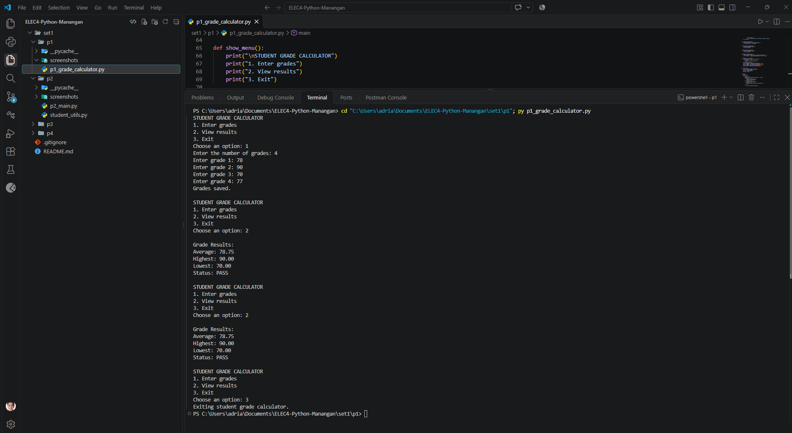
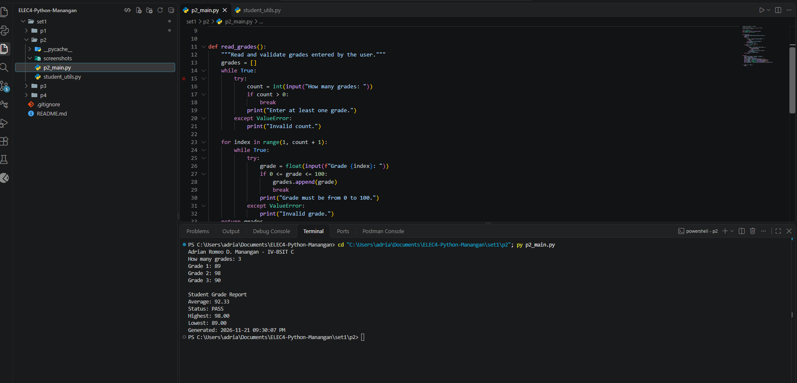
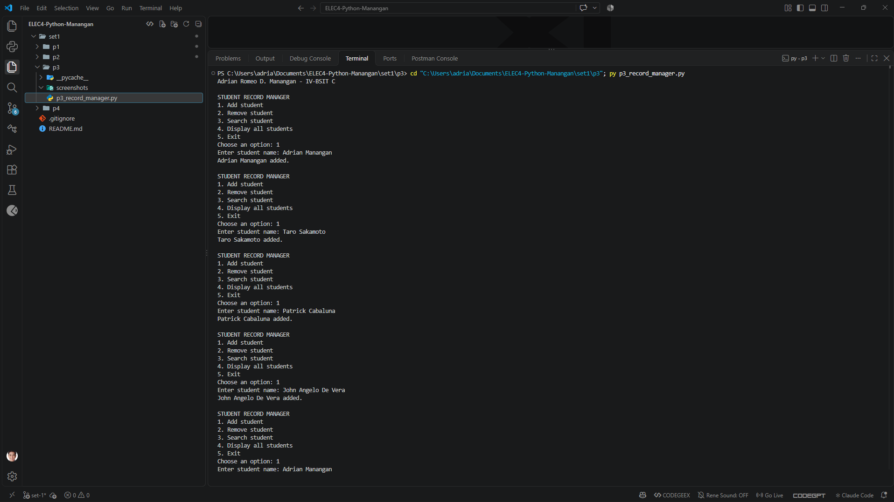
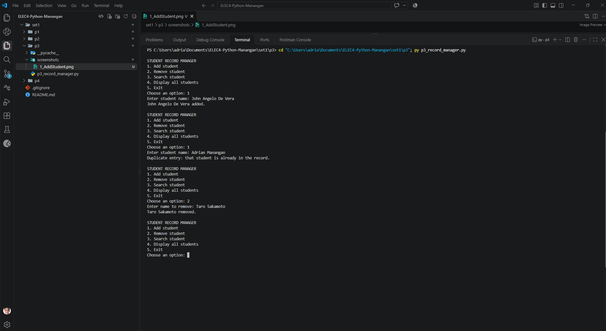
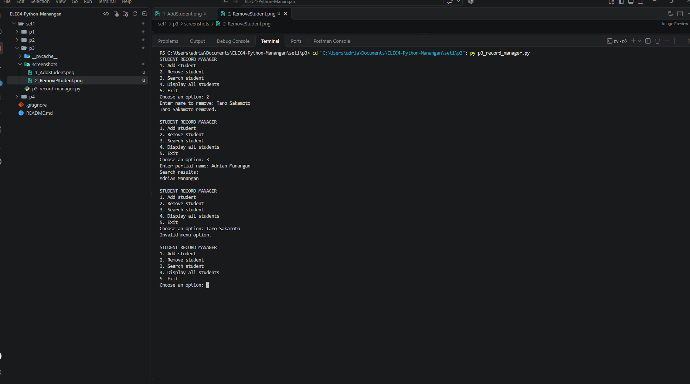
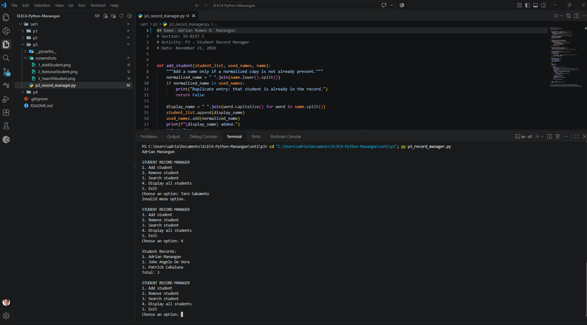
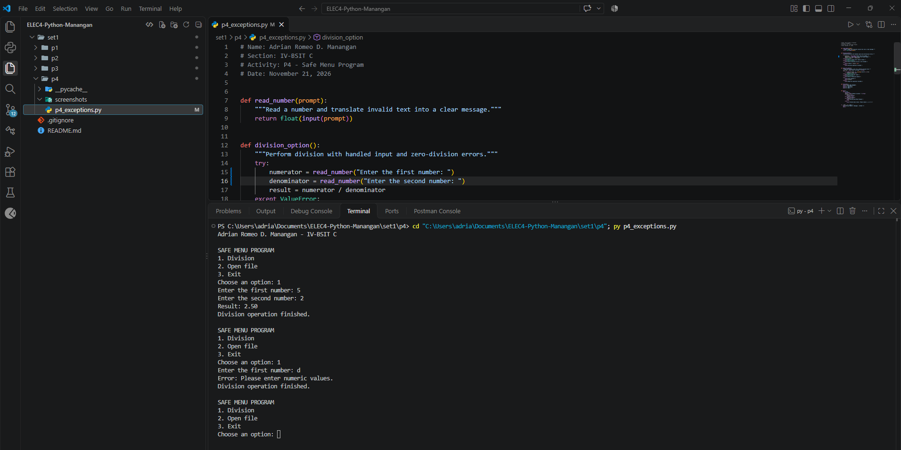
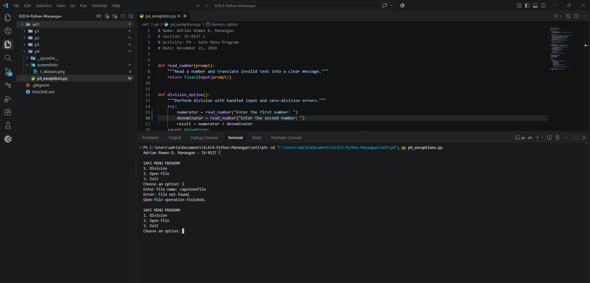
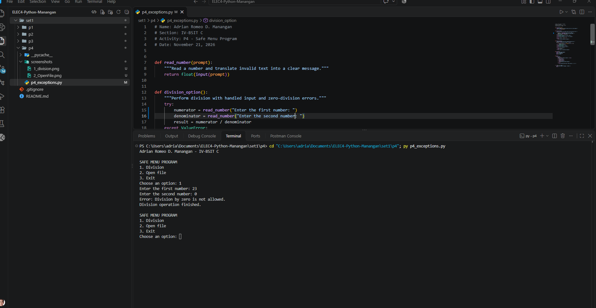
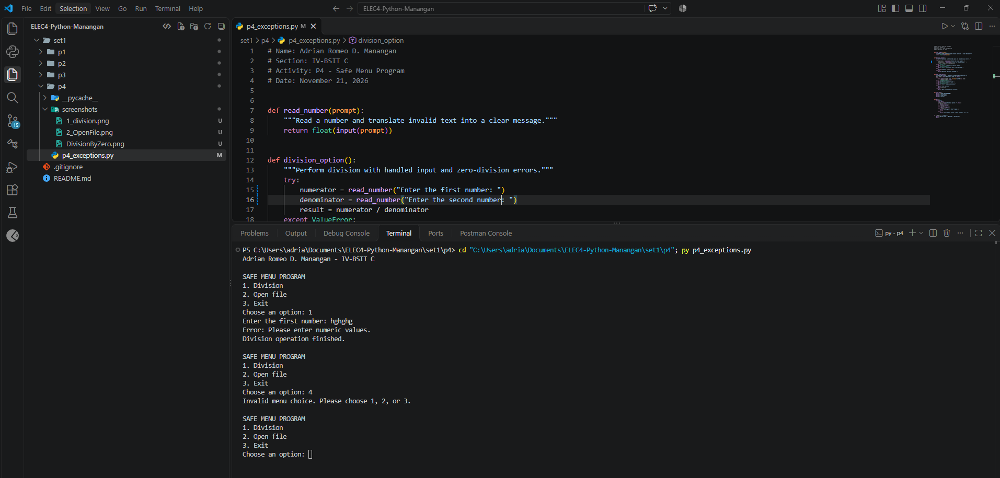

# ELEC4-Python-Manangan

Full name: Adrian Romeo D. Manangan  
Section: IV-BSIT C  
Course Code: ELEC 4 - Python Programming

## Set 1 Activities

| Activity | Description                   | Folder             |
| -------- | ----------------------------- | ------------------ |
| P1       | Student Grade Calculator      | [set1/p1](set1/p1) |
| P2       | Custom `student_utils` module | [set1/p2](set1/p2) |
| P3       | Student Record Manager        | [set1/p3](set1/p3) |
| P4       | Safe Menu Program             | [set1/p4](set1/p4) |

## How to Run

```powershell
python set1/p1/p1_grade_calculator.py
python set1/p2/p2_main.py
python set1/p3/p3_record_manager.py
python set1/p4/p4_exceptions.py
```

## Screenshots

Screenshots for each activity should be placed in.













